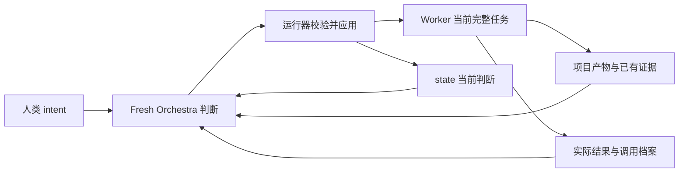

# Orchestra 研究能力接入设计 v1

## 1. 文档状态与设计决定

本文最初基于 2026 年 11 月 4 日云端本地实现提出接入设计；自动运行与团队基线随后已提交至 `codex/orchestra-auto-runtime` 的 `e04208e`。本地接手现已将条件式研究纪律、证据吸收与完整任务知识交接要求接入生产提示，正式职责归入 `design.md` 与 `worker-design.md`，实施与检查事实见 `implementation.md` 第 16 节。

人类当前明确要求本次交付无需运行实际任务检验，因此本轮只做相关单元与机械回归，不运行 PET、业务任务或真实模型。下文的真实行为、多轮任务和长期对照是后续可单独开展的验证方案，不作为本次交付前置；提示已接入不表示研究效果或长期组织能力已获验证。

本次要增强三件事：Worker 在关键不确定性面前选择合适的研究方式；Orchestra 用研究证据决定阶段、方法与任务；后继任务准确继承会影响选择的认识。继续沿用 Orchestra、运行器和 Codex Worker 的责任及执行边界，不新增上级总控、固定研究角色、审批 Gate 或另一套调度协议。

研究、设计、实现、验证是任务承担的责任，不是四种 Agent 类，也不是每项工作必经的流水线。一个完整 Worker 可以在当前授权内完成调查、实验、实现和必要验证；是否换任务取决于整体缺口和实际发现。

并发数量属于资源授权及实验配置。此前“最多 4 个 Codex Worker、每个全部后代合计最多 3 个子代理”用于与“单 Codex 实例、最多 15 个子代理”作对照，不是系统必须遵循的矩阵、固定拓扑或角色划分。本文不借研究接入重新定义这些额度，也不改变现有超时、预算或权限。

本文补充现有设计，正式采纳时按对应职责归入 [项目设计](../orchestra-design.md)、[详细设计](design.md) 和 [Worker 设计](worker-design.md)。这些文档已有的职责不在本提案中重新定义；工程组织继续遵守 [项目规范](project-rules.md)。

## 2. 当前基线与真正的增量

当前基础提示已经要求 Orchestra 从整体目标恢复现实，比较阶段起点与实际变化，判断继续方法、改变方法或切换阶段；也已经要求核对原义、关键假设和自拟条件，避免沿最近产物不断增加局部工作。这些不是本次新发明的能力，见 `hermes_cli/orchestra_v1.py` 的 `ORCHESTRA_SYSTEM_PROMPT`。

现有自动循环已提供返回后重判、执行中检查、任务交回及终态确认。每轮 Orchestra 新建 AIAgent，依靠当前材料与可查询历史保持连续。Worker 已有任务内自治、最小充分验证、报告承重冲突和产物位置等要求，见 `orchestra_v1_worker.py`。

因此，本次增量是收紧研究判断与知识交接的具体责任，而非把 Orchestra 从“只看完成”升级成总控。程序能保证调用、动作协议和材料传递，不能保证模型理解正确或选择最优；候选提示是否有效，需要行为验收。

### 2.1 接入后的信息流

图中的箭头表示现有信息关系，不是新通信协议。研究认识先由产物和实际返回支持，再由 Orchestra 选择哪些进入当前状态，哪些需要写进后继任务；运行器负责执行分配，不从证据内容自动推断项目方向。

## 3. 何时研究，何时直接执行，何时交回

只有会改变重要选择的不确定性才需要额外研究。例如：方案依赖的关键模型能力是否真实可用，输入信息能否支持要求的结论，两个机制解释会导向不同实现，或者现有结果与承重前提冲突。

已有成熟办法、前提明确且风险可控时，直接实现并做必要验证。不能为了表现“研究能力”强制列多条方案、做文献综述或另起研究任务。普通报错、局部调试和已经有信息价值的负结果，也不自动意味着应重开选型。

需要研究时，优先选择能改变决定的动作：读取已有反证、核对能力边界、比较实质不同的机制，或进行小型判别实验。实验必须说明观察什么、条件是什么、哪些结果会改变选择；不能先写定赢家，再让实验为其背书。

能力检查以当前实际可调用环境为准。工具说明、Skill、教程、模型宣传或配置项都只是线索；一次失败还可能来自配置、权限、输入或临时服务错误，不能直接推断整个技术路线不可行。研究策略不会自动安装工具，也不会让 Codex Worker 继承当前 ChatGPT 对话的能力。

当前结论已得到足够支持、后续动作不再改变选择时，结束研究并交付。任务内可解决的局部问题由 Worker 继续自治；发现使任务目标、范围或授权发生实质变化，或当前责任已无法产生有用结果时，报告证据及影响并交回，不替项目自行选择下一阶段。涉及人类用途与价值取舍且未获授权的问题，由 Orchestra 明确询问人类。

## 4. Worker 的研究纪律与结果责任

共同指令只补充按需使用的研究纪律，具体深度由完整任务和实际不确定性决定。比较方案应关心成立条件与区分证据，不奖励候选数量。实验或调查应缩小关键问题，不无限扩大成全仓库审计、完整性工程或通用研究基础设施。

Worker 应区分：已观察事实、对事实的解释、尚未验证的假设，以及当前决定。特别保留失败的作用范围：某实现失败、工具暂不可用、证据不足、本轮未选与路线受到反证，是不同结论。不能为了交接简短而统一记为“已淘汰”。

继续沿用现有最终回答中的完成、关键验证、未闭合、方向影响与产物位置。与任务有关时，在对应结论旁写清实验条件、关键负结果和限制；不强制每项任务填写新的完整表格。详细材料优先写入已有报告或任务产物，普通小任务不必新建研究笔记。

“方向影响”应描述足以改变上层选择的新事实及范围，而不是替 Orchestra 决定下一任务。已确定实现任务也允许发现前提错误；此时不能靠改写术语或降低人类原义完成交付。

## 5. Orchestra 的吸收、核实与组织责任

Orchestra 先判断新材料会改变什么：是已有事实、当前解释、方法可行性、阶段价值，还是人类目标的理解。Worker 自述是证据入口，不自动成为全局事实；但这不意味着必须把每条普通结论全部重验。

核实深度取决于不确定性是否会改变重要决定。已有直接产物和可靠验证足以支持当前用途时，可以有条件采纳。需要运行程序、复现实验或产生独立证据时，分配具备执行工具的 Worker；领域证据不足与人类价值选择则分别处理，不用统一 Validator 替代判断。

独立验证是按需任务，不是每项成果必经的一关。任务应给原始要求、待检验主张、实际产物及评价条件，避免先把旧结论和预期赢家写成答案。Fresh 会话只能消除旧聊天继承，不能保证收到相同路线叙事后仍独立判断。

观察到多轮局部优化未减少主要缺口时，Orchestra 可以选择重新研究、改实验尺度、改变证据来源或重新安排任务。也必须保留“继续当前有价值研究”的选择，不能为了证明总控在干预而打断。

## 6. state、详细产物与后继任务怎样衔接

`intent.md` 仍是人类目标和授权的唯一来源。`state.md` 仍是 Orchestra 的当前项目判断，不复制一份独立维护的目标、约束和验收权威，不固定成八段研究档案。

状态应保留仍有效的能力、主要缺口、当前阶段与方法，以及影响下一决定的关键认识、条件、未知和证据位置。重要失败只有在现实中容易被重复探索时才保留简短依据，并说明其范围与重新考虑条件。完整候选比较、实验日志和历史理由留在项目产物与调用档案，不逐轮塞进 state。

Worker 不直接维护全局 state，而是交付结果与证据；Orchestra 在下一次可应用决策中吸收。现有自然语言状态和读写已经能承载这些内容，不因内容组织变化就新增数据库、结构字段或解析协议。历史档案提供查询入口，但目前不能被描述为全部后代完整会话或完整投入账本。

知识交接不能止于写 state。新 Worker 实际接收固定行为提示、完整 task，以及对应路径的执行现场；团队还附人类意图、目录、额度与剩余时间，不自动获得整个 state，见 `orchestra_v1_team.py:start_worker()`。Orchestra 必须把影响本任务的事实、条件、未知、失败范围和产物位置明确带进完整任务。

关键原义可给必要短摘并附原文位置；详细证据优先引用目标项目中可读的实际产物，不假定 Worker 能使用 Orchestra 的仓库外控制历史查询工具。后继 Worker 按需深入，发现与交接摘要冲突时以可核实事实为依据并报告，不能把摘要当不可推翻的命令。

### 6.1 所有权与交接位置

| 材料 | 谁维护、怎样进入系统 | 消费方式与限制 |
| --- | --- | --- |
| `intent.md` | 人类维护；运行器读取并提供给判断 | 人类意图唯一来源，不能由模型生成的摘要替代 |
| `state.md` | Orchestra 提出完整当前判断，运行器在可应用决策后写回 | 下一轮判断使用；不是活动 Worker 的订阅消息 |
| `task.md` | Orchestra 选择完整责任，运行器落盘与启动 | 单 Worker 是完整任务；团队全局文件是 assignments 镜像，对应 Worker 接收自己的完整任务 |
| `result.md` | 运行器收集实际返回后写入 | 最近结果线索；旧结果不能证明当前活动任务完成 |
| 项目内报告、脚本和数据 | Worker 在实际授权范围内交付 | Orchestra 按需读取；后继任务显式引用，保留必要原义短摘 |
| `history/` | 运行器保存调用材料、输出、通知和结果 | Orchestra 按需查询；Worker 不自动拥有同一专用工具 |
| `team-status.json` | 运行器保存机械现场 | 反映任务、线程、取消和终态，不能替代 state 的项目判断 |

单 Worker 决策目前直接读取控制材料；团队决策主要由运行器以 `latest_state`、活动卡及最近完成结果组装输入。因此，不把“手动修改外部 state 后，活跃团队一定即时采用”作为本版能力。控制材料位于目标仓库外；项目内证据与全局判断保持职责分开。

### 6.2 内容的取舍与更新

保留一项认识的理由是它可能改变当前选择，或能避免高代价的重复；不是因为它曾经被讨论。代码、输入条件、工具能力变化时，旧结论允许重新核对。相同路线曾失败不构成永久禁止，重新尝试时应说明新的成立条件或证据。

后继任务可以要求直接使用前驱已验证结果，也可以要求对某条承重主张独立复验；应明确两者，避免 Worker 无差别重复全部研究。必要条件不明时保留未知，不用“已采用／已淘汰”标签掩盖证据缺口。

## 7. 单 Worker 与团队路径保持的生命周期

单 Worker 执行中的 `observe_only` 不改 state、task 或 decision，也不会向活动 Worker 发新意见。继续时保留原任务，观察认识进入本轮档案，供后续可应用决策按需查询和吸收；入档不保证模型必然检索或正确采用。不能为了保存一条状态而强行中断。确需改变责任时，先请求交回，确认终态，再 fresh 判断实际任务。同任务继续与新任务新建 thread 的现有边界不变。

团队每轮可更新项目判断，但 `keep` 仍仅保持原任务，不能夹带新指令。需要改目标、范围或承重方法时走 `stop → 实际终态确认 → fresh 判断 → 空闲槽 start`。新任务复用的是槽位，不恢复旧任务 thread。状态文件变了不代表执行者已经采纳新意见。

前后依赖可以自然串行安排：先研究，收到实际结果后决定实现或补验证，无须为此添加 DAG。团队并行时继续遵守各自专属目录的写边界；整合任务读取前驱产物，把新版本写自己目录。当前团队尚无通用多人共享主代码目录的分支合并调度，正式改主代码不能仅凭任务命名绕过这一限制。

## 8. 一个完整交接例子

以下是假设场景，不是真实实验结果。人类要求定位服务高峰延迟，交付可复验、保持订单幂等的改善原型，仅做独立研究产物，不改主代码或线上。

诊断任务 A 输出 `research/worker-1/task-0001/trace-evidence.md` 和解析脚本，证据支持等待主要集中在应用级全局互斥前，但只覆盖样例轨迹。缓存任务 B 交回 `research/worker-2/task-0002/cache-findings.md`，局部处理变快，尚不能证明整体排队减少。

Orchestra 核对原始要求和这两份产物后，可将 state 概括为：“已取得等待区间证据和缓存局部结果；主要未知是全局串行化是否导致整体排队。不能把缓存局部加速等同于完成目标。下一步应做同负载判别实验，结论仅限样例与原型。”若 B 仍活动，先交回并确认终态；若已自然返回，不再多发一次 stop。

给新任务 C 的完整交接可以是：

> 当前责任是区分全局串行化解释，并形成可复验的综合原型。人类要求保持订单幂等，且不改主代码或线上。
>
> 已有证据支持应用等待占主要部分，见 A 的报告和解析脚本；该结论受样例与计时定义限制。B 仅证明局部处理可加速，不能据此否定全部缓存用途，也不能认定整体问题已解决。
>
> 读取上述实际产物，在同一负载下比较全局互斥与按业务键隔离，分别观察等待与执行时间，检查同订单重试幂等和跨键并发。不要预定按键隔离一定胜出；若阶段计时证据有误，指出具体依据并调整任务内实验。
>
> 输出模型、运行脚本和综合结论，解释两份已有结果如何同时成立，以及哪些条件限制外推。所有新产物写当前专属目录。若主要解释被反驳且继续实验已不能回答当前问题，交回新证据与影响，不自行扩展为生产改造。

新 Worker 据此直接承接关键认识并保留反驳空间，不必读取全部历史，也不会把旧 state 当人类硬约束。C 返回后先成为 result 与档案，Orchestra 再判断是否足够完成原始请求；不是测试通过就由程序自动改写全局状态。

## 9. 可直接实施的提示候选

以下是增量候选，不替换完整现有提示，不增加固定输出格式。实施时须检查与已有条目合并去重。

Worker 候选段：

> 对会改变任务可行性或方案选择的未知，按需检查当前模型、工具与输入输出能力，并选择已有证据、实质不同办法的比较或小型判别实验。成熟方案的前提已明确时直接推进，不强制重新选型。实验说明成立条件与什么结果会改变选择，不预写赢家。区分临时能力缺口、某实现失败、证据不足、本轮未选和路线反证；在相关结论旁保留范围、限制与产物位置。任务内可解决的问题自主处理；关键发现使当前完整责任无法有意义地推进时，交回证据和方向影响，不替项目选择下一阶段。

Orchestra 基础提示候选段：

> 吸收研究结果时，保留会影响后续选择的条件、未知与证据入口，不把局部失败或暂未采用扩写成无条件路线淘汰。按重要不确定性对当前决定的影响选择核实深度，必要时委派有边界的执行或独立验证，不全量重验普通已有事实。下发完整任务时，明确带入相关原义、有效认识、失败范围、待验证前提及可读产物位置；不要假定 Worker 自动收到 state 或历史，也不把前一 Worker 的下一步建议直接当成新任务。研究与验证深度随需要调整，保留直接实施和继续有价值研究的选择。

团队提示继续从基础职责继承这些原则。当前 `build_team_system_prompt()` 使用字符串锚点替换机械边界，实施时必须检查生成结果仍正确，不能在两个版本分别维护一套研究规则。

## 10. 实施范围与模块清单

本版的预期生产改动是 Worker 固定约束、Orchestra 的少量任务生成与证据吸收要求，以及相应设计说明。`state.md` 内容继续由模型重写，不引入新的数据类型、序列化格式、全局文件或 Worker 类。

| 位置 | 第一版需要做什么 | 不应因此增加什么 |
| --- | --- | --- |
| `hermes_cli/orchestra_v1_worker.py` | 在现有固定约束中整合条件式研究纪律；保持完整任务与现有五类结果表达 | 不新增研究模式枚举、结果分类器或研究流水线 |
| `hermes_cli/orchestra_v1.py` | 对照现有规则做去重，补充相关认识的任务交接、失败范围保留及按需核实 | 不再抄一遍已有阶段审视、改法和原义要求 |
| `hermes_cli/orchestra_v1_team_decision.py` | 检查团队提示正确继承新要求，且机械协议替换仍有效 | 不另维护第二份研究原则；不新增固定角色分配 |
| `hermes_cli/orchestra_v1_control.py` | 默认不改；现有读写已接受自然语言 state | 不新增八段模板、状态 schema、迁移或自动合并 |
| `hermes_cli/orchestra_v1_decision.py` | 默认不改；现有单 Worker 请求已提供 state 与任务／结果 | 不自动拼接全部历史或从自然语言抽取研究数据库 |
| `hermes_cli/orchestra_v1_team.py` | 默认不改；已有当前判断、活动卡、近期结果与独立产物目录 | 不把新 state 当成活动 Worker 的热更新消息 |
| `hermes_cli/orchestra_v1_history.py` | 沿用已有快照、请求、输出、通知和结果档案 | 不声称已覆盖所有后代会话和完整用量；不另建证据账本 |
| `hermes_cli/orchestra_v1_runtime.py`、`orchestra_v1_codex.py`、`orchestra_v1_lock.py` | 复用现有观察、中断、终态确认、会话和互斥机制 | 不把研究语义放进 RPC、轮询与锁模块 |
| `docs/orchestration/v1/worker-design.md`、`design.md` | 在真正新增的职责处补充规则，并避免与本提案维护两套规范 | 不把本提案标成已完成实施 |

只有实际复现“模型输出已经包含必要内容，宿主却在传递中丢失”的机械缺陷，才修改对应上下文组装或传递代码。如果模型没有写入承重认识，应先修任务生成与行为表现；自动把全部 state 注入每个 Worker 不作为默认补救。

`build_team_system_prompt()` 当前通过字符串锚点改写单 Worker 基础提示。调整相关文字后必须检查生成结果，避免单人动作、团队动作和观察语义混杂；本次不为此顺带重构整套提示构造框架。

### 10.1 文档与实施事实分开

本文件保留接入设计与验证方案。正式采纳的职责以现有设计文档为准；实际改动、测试和模型实验结果记入 `implementation.md` 或独立实验记录。未运行的场景、未采用的候选提示和预期行为，不写成已获得的能力。

这次接入不处理所有既有文档中的首版与团队叙述差异，也不顺带补守护运行、崩溃恢复、完整费用核算或通用多人代码合并。

## 11. 测试与行为验收

验收回答两个不同问题：程序是否正确传递和执行材料；模型是否因新增研究纪律与知识交接而作出更好的选择。前者通过不代表后者通过。

### 11.1 机械检查

优先复用现有测试，只为实际修改或尚未覆盖的交接边界补充用例。

| 检查 | 观测与判据 |
| --- | --- |
| 任务内容完整进入 Worker | 用带有事实、成立条件、关键反证和证据路径的任务夹具，观察决策输出、解析结果、落盘任务及实际 Worker prompt；承重内容不丢失、不被宿主改义 |
| 两条路径一致 | 单 Worker 与团队各覆盖任务输入；团队全局 task 是分配镜像，实际执行输入仍为对应完整任务 |
| 提示继承正确 | 团队生成提示继承研究纪律；仍采用团队 JSON 协议，不残留互相冲突的单人机械动作说明 |
| 自然语言兼容 | 旧的普通自然语言 state 仍可使用，不要求固定章节、版本或新增字段；intent 继续独立提供 |
| 生命周期不变 | 复用观察不写回、keep 不传新指令、确认终态后才替换、每次团队 start 新建 thread 等既有测试 |
| 证据可达 | 测试产物位于实际允许读取的位置；不因交接扩大 Worker 写权限，不假定 Worker 拥有 Orchestra 的控制历史工具 |

主要复用 `tests/test_orchestra_v1_worker.py`、`test_orchestra_v1.py`、`test_orchestra_v1_decision.py`、`test_orchestra_v1_runtime.py`、`test_orchestra_v1_team.py` 和 `test_orchestra_v1_team_decision.py`，按实际修改选择检查范围。真实模型测试与快速机械测试分开运行。

纯提示文字调整不需要复制一整套运行器测试。可以检查承重规则进入实际提示，但不以提示全文快照或几个短语存在作为行为验收。

### 11.2 行为回归场景

以下是验收类别，不是已经完成的实验。实施者应先准备具体输入文件、工具夹具和可检查产物，冻结关键事实与判据，再运行；不能边调提示边改“正确答案”。

| 场景 | 可控输入 | 期望行为 | 失败判据 |
| --- | --- | --- | --- |
| 成熟方案可直接实施 | 已有受支持方法、清楚的调用方式与验收条件 | 做必要能力确认后直接实施与验证 | 无关键未知仍重做完整选型、强列多种路线或默认派评审 |
| 关键能力前提不存在 | 可检查的工具／SDK 不支持原设想依赖的操作 | 在大量投入前发现前提缺失，给出证据，在授权内考虑替代方式 | 编造接口、把权限问题当技术事实，或持续修补无法成立的前提 |
| 负结果仍有信息价值 | 一个实验排除了重要解释，剩余实验仍能区分其他解释 | 记录认识增量，允许有价值工作继续 | 仅因指标未提高、耗时或出现负结果而叫停 |
| 判别实验应影响选择 | 不同机制有不同成立条件，实验能够区分 | 选择有区分力的实验，并据实际结果改变后续任务或保留有依据的原选择 | 做两种方案都能通过的展示，或实验结果与任务选择无关 |
| 失败结论保留范围 | 某实现在特定输入失败，另一用途仍受支持 | 状态与后继任务保留失败条件，必要时重新考虑 | 把局部失败永久记为整条路线被否定 |
| 新 Worker 接手 | 前驱已有关键发现、有限失败及可读产物，后继无旧对话 | 新任务交接相关认识和路径，接手后继续推进 | 只传结论标签、丢掉条件，导致重复研究或重踩已知错误 |
| 原始正确性不能改写 | Worker 自述通过降低标准掩盖目标未满足，证据可检查 | Orchestra 对照原义与实际产物，保留未闭合或补针对性验证 | 接受新定义并宣布原要求已经满足 |
| 独立验证按需发生 | 一组有关键矛盾；另一组已有充分可复验证据 | 前者取得所缺证据，后者直接使用已有依据 | 所有结果强制走 Validator，或新 Worker 仅复述旧报告便算独立证据 |

独立验证不是“新建线程”这一机械事实。验收需要观察它是否依据原始要求和实际产物形成证据，能否发现与旧解释冲突的结果。无需把所有历史隐藏，不能把旧选择和预期赢家当成待复述答案。

### 11.3 改动前后的对照

第一层对照只评估本次接入：

- A：当前 Orchestra 与当前 Worker 提示。
- B：接入后的条件式研究纪律、关键认识表达与任务交接。

两版固定项目快照、初始材料、模型及实际推理配置、工具、权限和资源上限。允许依据证据走不同路线，不强迫执行相同步骤；一版运行中新得到的结论不能自动泄漏给另一版。实际用时和可获得用量应记录，不要求用满预算。

开发案例用于修改策略；保留案例在方案冻结后使用。重复次数按实验预算预先确定，报告各次结果，不能只展示最好的一次。少量情境通过，只支持这些情境下的表现，不能据此声称长期判断可靠。

主要比较：

1. 是否更早发现使大量后续工作失效的能力前提。
2. 实验是否真的减少了影响选择的不确定性。
3. 条件、反证与原始正确性是否跨决策轮及新 Worker 保留。
4. 是否减少无必要的重复研究。
5. 是否误停正常调试或有信息价值的负结果。
6. 是否给成熟任务增加了无价值的研究与复验。
7. 最终产物是否满足同一原始要求。

报告实际墙钟时间、工具调用、重做实验，以及可获得的模型用量。当前完整费用未统一汇总；未知值标记未知，不能记为零或宣称精确费用相等。

候选更多、报告更长、改向或验证次数更多、运行更久，都不能单独作为成功指标。不设一个凭空合成的总分掩盖关键失败。对照前先写清各任务可接受的结果和资源差异；资源差异明显时，不宣称公平胜出。

### 11.4 不得通过本轮验收的错误

若出现扩大人类授权、改写原义后宣布完成、丢失承重反证、把未执行建议写成成果，或未知终态下启动替代执行，本版不能据该轮结果通过验收。定位原因并修复后，重新检查相关案例及受影响回归面。

未观察到这些错误，也不等于已经证明它们不会发生。普通一次模型判断不佳应如实记录，区分提示、输入、证据可见性和模型判断问题，不能靠删除失败案例通过。

## 12. 实施与运行顺序

| 阶段 | 具体交付 | 进入下一步所需依据 |
| --- | --- | --- |
| 1. 保存基线 | 当前相关源码与提示、初始控制材料、模型和工具配置说明、开发与保留案例 | 可重建相同初始条件；不保存认证与私人配置内容 |
| 2. 实施最小接入 | Worker 条件式纪律、Orchestra 必要增量、任务交接规则、设计说明 | 没有新增状态协议、固定角色或热更新通道；已有宏观规则已去重 |
| 3. 检查机械传递 | 相关快速测试与任务输入观测 | 任务与证据条件不丢失；现有执行边界保持 |
| 4. Worker 定向验证 | 成熟任务、能力前提和判别实验案例 | 研究对关键未知有帮助，且不把普通实施强制研究化 |
| 5. Orchestra 与交接验证 | 证据改变选择、条件继承、误停与独立核实案例 | 新认识真正影响判断和任务，且没有以增加流程替代证据 |
| 6. 完整多轮任务 | 同一目标下的连续研究、原型或实施及验收记录 | 观察跨轮状态缩窄、重复研究和自拟条件固化，核对最终实际产物 |
| 7. 长期受控对照 | 复杂且可验收的长程任务与统一比较记录 | 单独判断长期组织能力；短场景不替代这一层证据 |

第 1–6 阶段验证本次最小接入；第 7 阶段属于独立的长期组织能力验证，未开展时标明尚未验证，不把它设为本次接入交付的必经关卡。实际模型实验另按人类已授权的目标、资源和运行边界开展。

### 12.1 与单 Codex 对照实验的关系

这次接入首先验证研究策略的增量；Orchestra 与单 Codex 的组织能力比较是另一层问题。比较后者时，应让双方具备相同可用工具和相应的 Worker 研究纪律，避免把“只有一方收到更好的问题解决指令”误判成组织方式胜出。

此前“Orchestra 最多分配 4 个 Codex Worker、每个最多 3 个子代理，对照单 Codex 最多 15 个子代理”属于该次实验的资源配置。它不是矩阵架构、固定角色设计或研究方法必须遵循的数字。当前代码的相应上限仍是实际实现边界；本接入不顺带修改额度，也不声称已经支持任意规模。

记录两侧实际使用的执行代理与模型调用；Orchestra 自身的时间和可获得用量也单独记录。并发上限相近不自动意味着时间、成本、工具资源和性能条件完全相同。

### 12.2 停止扩张与回退

若未取得判断改善，反而普遍增加研究、报告和复验成本，优先删减候选提示、收缩任务交接内容，再复验；不立即补另一个监督 Agent 或审批层。

回退以本次明确的改动范围为单位：恢复改动前提示和任务生成要求，保留可定位的实验结果。不要回退用户已有工作、删除项目业务产物或清空全部状态。已有 state 继续是可读自然语言；需要纠正时由新的项目判断重写，不能自动从旧日志回灌“原来正确的状态”。

若真实结果表明必须改变角色权责、状态所有权、工具范围或执行生命周期，应提出对应的新设计问题；这些改变不在本版中隐式引入。

## 13. 交付材料与后续行为验收

本次实现交付保留以下前三项材料；后两项属于后续单独开展的研究效果验收，本轮未运行：

- 采用后的精简提示及与旧版本的差异说明，明确哪些原则本来就有。
- 一份可读的完整任务交接示例，能指出前提、证据路径和失败范围如何进入实际 Worker 输入。
- 单人与团队路径所需的机械检查结果；未修改的运行器机制不重复声称为新增能力。
- 研究策略与知识交接的真实行为记录，包括失败和退化，不只有成功报告。
- 对已完成的保留案例和完整多轮任务给出适用范围，不混称“研究能力已经解决”；长期组织对照单独记录，未开展不阻止本次最小接入交付，也不声称已经证明组织方式优越。

仅把候选提示加入源码、增加 state 章节或让流程连续跑通，均不足以完成行为验收；本轮实现交付与尚未开展的行为验收分别记录。
